# Scribbles ✿

A tiny, doodly app for lists, recipes, notes and monthly recaps. It's minimal, cute and hand-drawn, a bit like a notebook page, and it syncs between your devices.

**Live:** https://scribble-lists.vercel.app

<p align="center">
  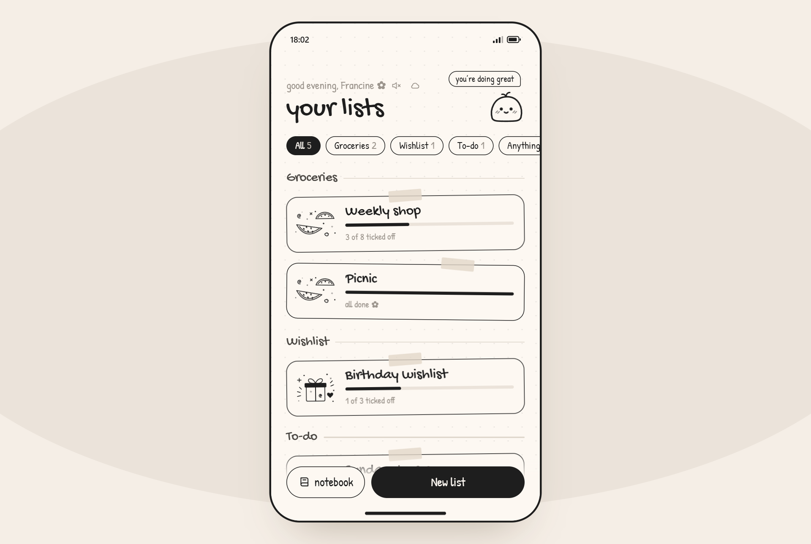
</p>

## Screenshots

<table>
  <tr>
    <td align="center">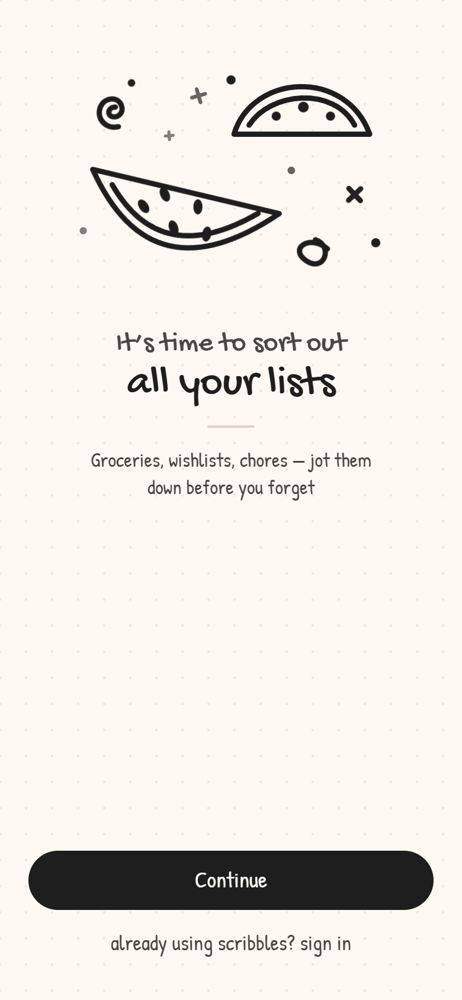<br><sub>Welcome</sub></td>
    <td align="center">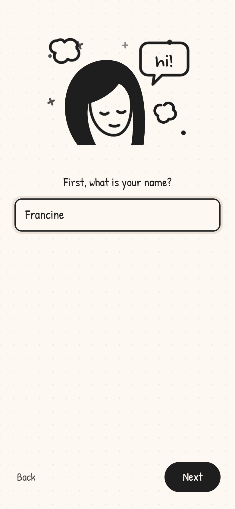<br><sub>What's your name?</sub></td>
    <td align="center">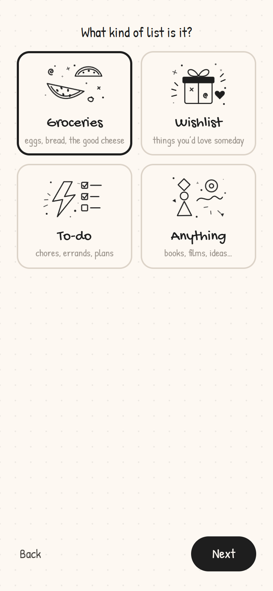<br><sub>Pick a list type</sub></td>
  </tr>
  <tr>
    <td align="center">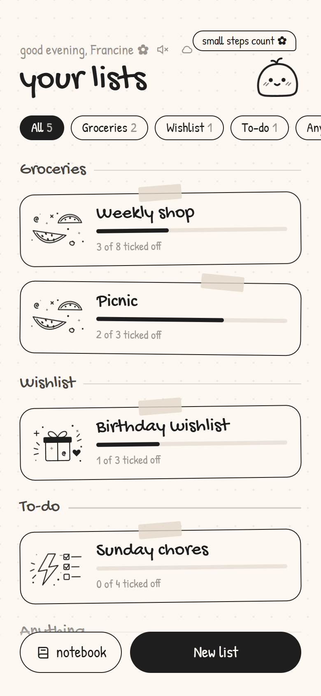<br><sub>Lists, grouped by type</sub></td>
    <td align="center">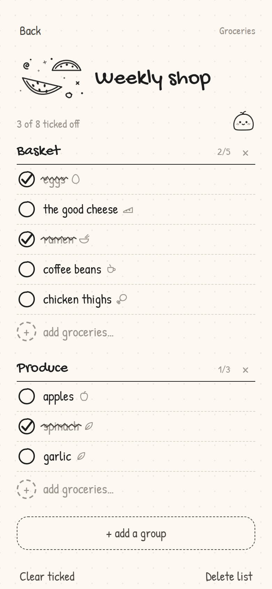<br><sub>Groups, scribbles &amp; stickers</sub></td>
    <td align="center">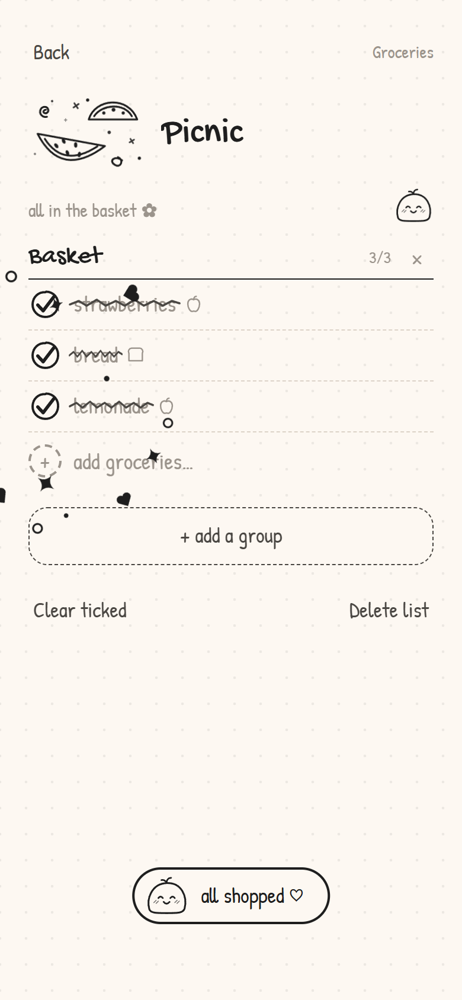<br><sub>All done celebration</sub></td>
  </tr>
  <tr>
    <td align="center">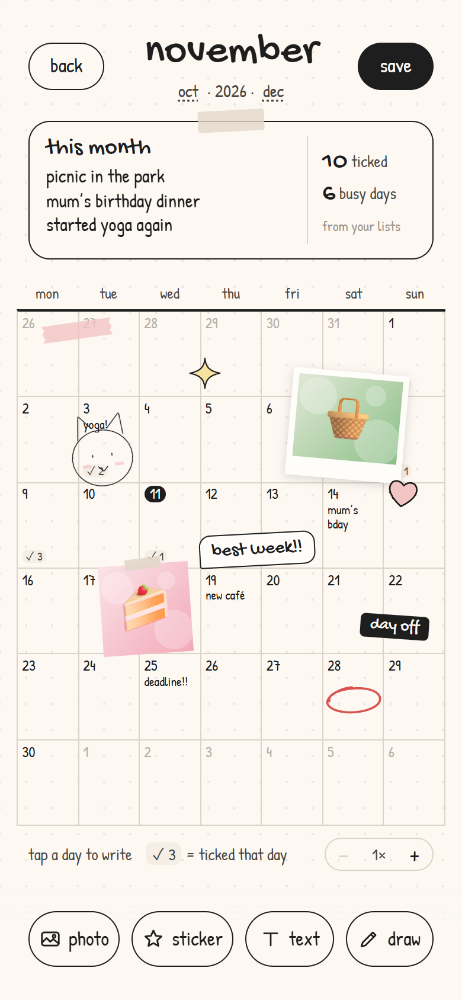<br><sub>Monthly recap</sub></td>
    <td align="center">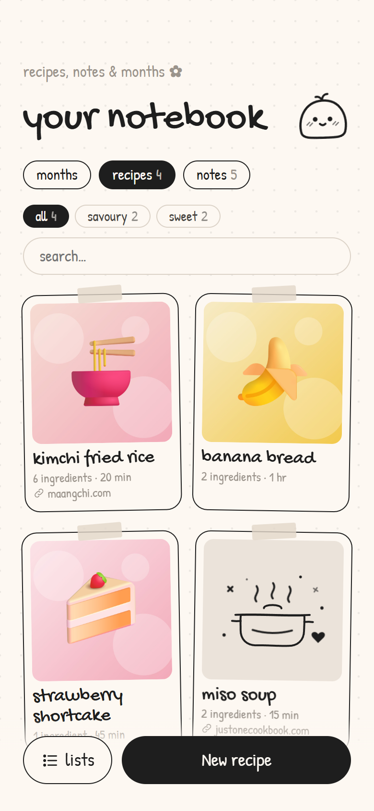<br><sub>Notebook: recipes</sub></td>
    <td align="center">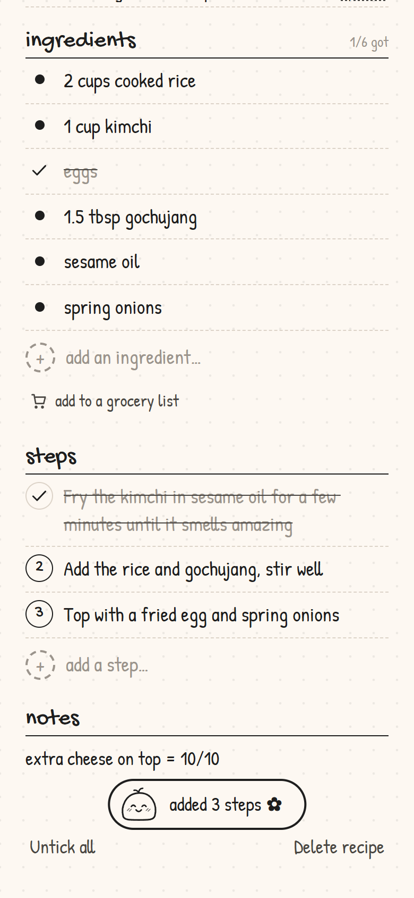<br><sub>A recipe</sub></td>
  </tr>
  <tr>
    <td align="center">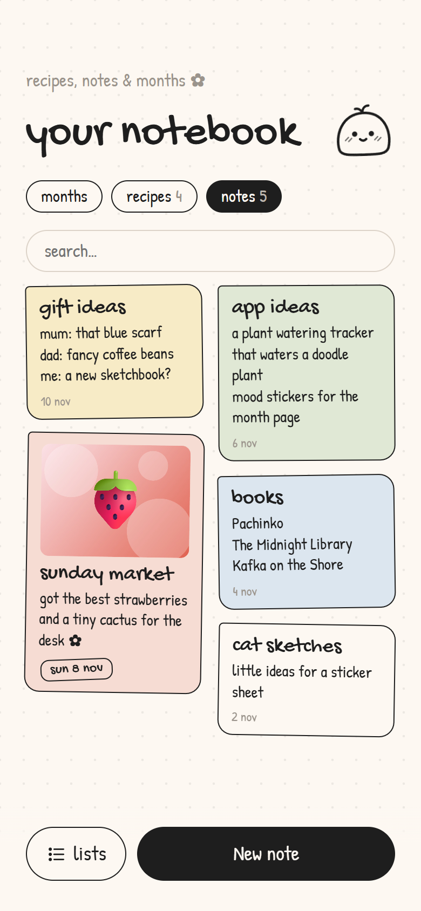<br><sub>Notebook: notes</sub></td>
    <td align="center">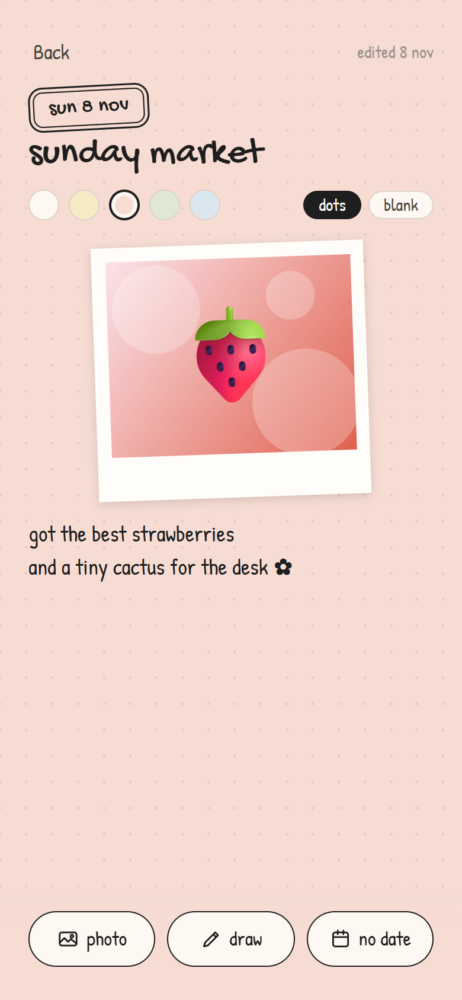<br><sub>A note with a photo &amp; date stamp</sub></td>
    <td align="center">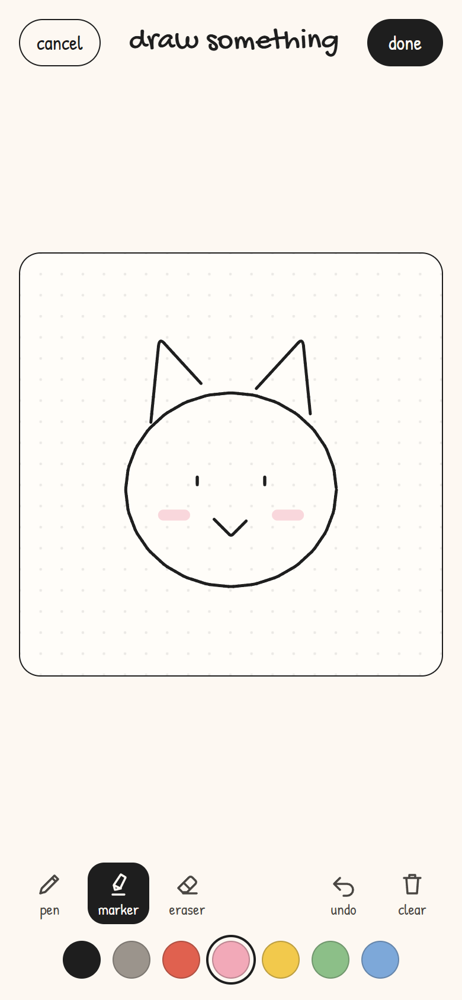<br><sub>Draw your own</sub></td>
  </tr>
  <tr>
    <td align="center">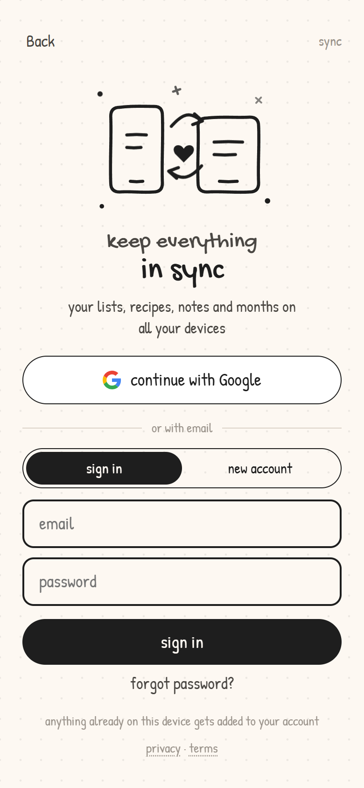<br><sub>Sign in &amp; sync</sub></td>
  </tr>
</table>

## Features

**Lists**
- **Lists by type:** Groceries, Wishlist, To-do or Anything. The home screen groups your lists by type, and you can filter them.
- **Groups inside a list:** for example "Basket" and "Produce" in a grocery list. Tap a name to rename it.
- **Satisfying tick-offs:** a crayon scribble crosses each item out, with small sparkles. Finishing a list gets a bigger burst and a note from the mascot.
- **Auto stickers:** small line icons appear on items like eggs, ramen, soap, coffee and gifts, and on everyday stuff like workouts, naps, chores, pets, plants, bills… and poop 💩.
- **Wishlists with photos and links:** give each wish a photo (cropped square) and a link to where to buy it. Paste a shop link straight into the list and it becomes a wish, named from the page's address. Save the whole wishlist as an image or a PDF, where the links can be tapped.
- **Repeating items:** tap the loop icon to repeat an item every day, week, 2 weeks or month, or only on certain days (like Mon · Thu). It unticks itself when it's due again. Only to-do and "anything" lists repeat.

**Notebook** (the second little app, next to your lists)
- **months:** a doodly calendar page for each month. Write a note on any day, add photos, stickers (doodles, scribbles, stamps, tape and arrows), your own words and your own drawings, then drag, pinch and twist them into place. Zoom in with the + / − buttons or two fingers. Days show how many things you ticked off, and tapping a day lists them. Save the page as an image or a PDF.
- **recipes:** sorted into savoury and sweet. Each one has a photo (cropped square when you add it), time, servings, a link to the original, bullet-point ingredients, numbered steps and notes. Paste a whole ingredient list or method and each line becomes its own row. Tick things off while you cook, and send the rest to a grocery list in one tap.
- **notes:** a dotted or blank page in five paper colours, with photos (polaroid, taped, round or plain), drawings and an optional date stamp. Search appears once you have a few.

**Drawing**
- A drawing pad with a pen, a see-through marker and an eraser, seven colours, undo and clear. With an Apple Pencil, lines get thicker the harder you press, and your resting hand won't draw. Drawings can be edited later, stroke by stroke.

**Sync**
- Sign in with **Google**, or with an email and password, to see everything on all your devices. The first sign-in on a device adds whatever is already on it to your account. It keeps working offline and catches up when you're back.

**The feel**
- **Hand-drawn:** ink doodles with gentle idle animations, handwritten fonts (Gochi Hand and Patrick Hand), and cards taped on like paper scraps.
- **A mochi mascot:** it blinks and sways, hops when you add something, and says something nice when you tap it.
- **Cute sounds:** a paper-scratch when you tick something off, pops, a boing when you poke the mochi and a little chime when a list is done. All made in the browser, and you can mute them from the home screen.
- **An easter egg:** try typing a certain song name 🎵
- **Reduced motion:** turns the animations off when your device asks for less motion.
- **Installable:** it's a PWA, so you can add it to your home screen and it opens full-screen like a normal app, even offline.

## Your data

Everything is saved on your device first (localStorage, with photos and drawings in IndexedDB), so the app works without an account. When you sign in, it syncs through [Supabase](https://supabase.com): your things live in a private table and photo folder that only your account can read or change. No ads, no tracking. See the [privacy page](https://scribble-lists.vercel.app/privacy.html) and [terms](https://scribble-lists.vercel.app/terms.html).

## Install on your phone

- **iPhone (Safari):** open the site, tap **Share**, then **Add to Home Screen**.
- **Android (Chrome):** open the site, tap the **⋮** menu, then **Install app** (or **Add to Home screen**).
- **Desktop (Chrome / Edge):** click the install icon in the address bar.

## Tech

Plain HTML, CSS and JavaScript, with no framework, no libraries and no build step.

| File | What's in it |
| --- | --- |
| `index.html` | Page shell and fonts |
| `style.css` | Look, layout and animations |
| `app.js` | Doodles, mascot, screens and saving |
| `recap.js` | Month stickers, photo storage and the image / PDF export |
| `draw.js` | The drawing pad: pen, marker and eraser, colours, undo, and Apple Pencil pressure |
| `sync.js` | Sign-in (Google, or email and password) and syncing with Supabase over plain fetch: what changed here, what changed elsewhere, merging, photos |
| `privacy.html`, `terms.html` | The privacy and terms pages |
| `manifest.webmanifest`, `sw.js`, `icons/` | Home-screen install and offline support |

## Run locally

Serve the folder with any static server:

```
npx serve .
```

Sync talks to the Supabase project set at the top of `sync.js`.

## Deploy

The repo is connected to Vercel, so every push to `main` deploys to https://scribble-lists.vercel.app. Pushes to other branches get their own preview links.
